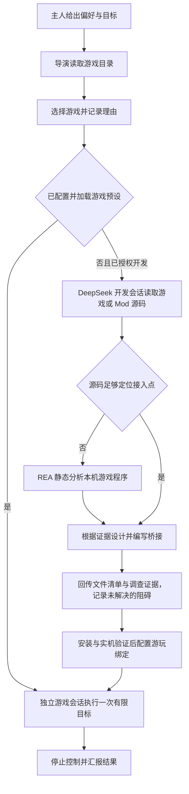

# dsh-game-director：让 DSH 自己选游戏、写接入

独立的 DSH 插件，提供「大肥鱼·游戏导演」和「游戏接入开发」两个预设。

游戏导演读取目录后决定玩什么，记录理由与有限目标。已有接入时启动对应游戏会话；缺少接入时，通过 DSH 原生子会话接口运行 DeepSeek，让它检查游戏源码；缺公开源码时通过已安装的 REA 静态调查游戏程序，再据真实接入点编写适配。

**当前是源码预览；早期初版曾构建并加载到本机 DSH NEXT 2.0.20-next，后续新增部分尚未重建或更新客户端。** 未运行测试，也没有启动实际开发子会话或验证完整自主开发/游玩。生成接入不能自动变成“已验证可玩”，详见[本机安装记录](../../docs/local-installation.md)。

## 工作流程



选择由 DSH 当前模型依据主人偏好和目录状态完成；插件提供工具和记录，不把固定的随机挑选包装成自主决策。

第一版内置星露谷目录项，可使用同仓库的 `dsh-stardew` 样例。模型也能提出新的游戏候选。目录不会扫描 Steam 库；游戏是否安装、是否进入存档，交给对应驱动检查。

## 安装与使用

本机安装已执行的构建步骤，其他环境可按相同步骤安装：

```bash
pnpm install
pnpm -C packages/dsh-game-director build
# 如需从导演启动星露谷，还要构建并启用本仓库更新后的星露谷包：
pnpm -C packages/dsh-stardew build
```

在 DSH 的插件管理中添加 `packages/dsh-game-director` 的绝对路径并启用，重启 DSH。需要 DSH 提供以下真实服务：

- `subagents.startActivation`、`getProvider`、`resolveMaxDepth`、`drainChildren`，以及支持 `agentOptions` 的 `spawn` 本机提供方。
- `agentPresets.list` 和 `workingDirectory.ensure`。
- `llm.resolveCallConfig`，用于派发前解析指定的开发模型路由。
- 开发预设使用官方 `dsh-tool-fs`、`dsh-tool-fs-search` 和 Bash／PowerShell 工具，沿用宿主的文件权限、沙箱和审批策略。

接口依据是开发时读取的官方 `master` 文档与源码；本机安装另核对了客户端内置 DSH 0.2.1-rc.3，并修正文件搜索工具必填的 `sampleOverCapGlobResults` 配置。已确认插件加载，实际子会话派发仍未执行。

新建对话，选择「大肥鱼·游戏导演」，例如发送：

> 我喜欢经营和探索类游戏。你自己选一个适合 Mac 的游戏，说明为什么。已有可用接入就玩一次有限目标；没有接入就让 DeepSeek 自己看游戏代码，没有公开源码时可以用 REA 静态分析，再在当前工作区写出接入源码。先不编译、测试或安装。

子会话在 DSH 原生界面中留下过程记录。任务工具立即返回 `childId`，DSH 自己发送结束通知；导演不需要持续轮询。

本版导演是独立对话入口，**尚未接入直播控制台的自动选游戏选项或将子会话解说转播到直播线**。原来的星露谷直播入口照常使用。

## 工具

| 工具 | 行为 |
| --- | --- |
| `game_library` | 读取目录、绑定的真实预设状态、当前选择和本会话最近任务 |
| `game_choose` | 记录游戏 ID、名称、选择理由和玩法目标；新游戏先成为候选 |
| `game_develop` | 运行 DeepSeek 开发会话，支持 `source_path`、`repository`、`artifact_path` 和 `references` 调查线索 |
| `game_play` | 用已配置游戏预设启动一次游玩子会话 |
| `game_task` | 读取任务状态、子会话结果和开发报告 |
| `game_cancel` | 停止本会话的任务，并请求游戏驱动释放对应控制连接 |

这组工具与具体游戏的 `game_start / game_act / game_stop` 分属不同预设。开发预设没有导演工具，因此不能递归派发新的开发任务。

## 开发交付

开发任务继承调用者的工作目录，在以下独立目录新增文件：

```text
<当前工作区>/game-adapters/<game-id>-<task-id>/
```

开发目标包含 `package.json`、`cordis.patch.yml`、驱动源码、README 和 `investigation.md`。驱动参考星露谷的 `start / observe / act / stop` 接口与 `active / finished` 状态，不要求复制星露谷的游戏规则。

开发预设固定为源码模式：不安装依赖、不编译、不测试、不启动游戏、不安装插件、不暂存或提交代码。输出目录是任务约束；真正的文件执行权限由 DSH 提供，预设本身不是操作系统沙箱。

结构化结果包含 `outcome`、`summary`、`files`、`blockers`，以及 `inspection` 中的调查方法、证据定位、接入点与局限。新任务缺少调查证据、接入点或 `investigation.md` 文件记录时，不接受 `source-ready`。

这些内容仍是开发会话报告，不是目录控制器对代码的独立验证；记录为 `developer-report`，不会自动执行或修改游玩绑定。没有现成插件不直接判定失败：继续读源码或分析程序；仍找不到可行控制路径时返回 `blocked`。

## DeepSeek 与 REA

开发子会话默认显式使用 `deepseek-official / deepseek-flash`，与所查 DSH 基础配置的默认路由一致。可在插件设置的 `developerProvider`、`developerModel` 中填写当前 DSH 中实际配置的 DeepSeek 路由。启动前解析该路由，解析失败时直接报告，不悄悄换模型。解析成功不等于一次真实模型请求已经成功；任务记录的 `modelRoute` 保留实际请求的路由。

REA 走开发预设已有的 Bash／PowerShell 工具；`reaCommand` 默认是 `rea`，也可填已安装的可执行文件绝对路径。这是开发提示词与 CLI 工作流接入，实际命令由 DeepSeek 通过 DSH 终端工具执行，没有新增专用 REA 执行器。预设要求把该配置作为单个程序名正确引用，不能填写整条 shell 命令。

调查顺序：

1. 查工作区相似实现、官方 API 和已有 Mod/MCP。
2. 缺少现成接入时，读给出的 `source_path`；或自行寻找官方公开源码，核对来源与版本，定位真实状态和动作入口。
3. 缺源码时，定位 `artifact_path` 或实际安装文件，读取 REA 版本与命令帮助，再做格式对应的静态分析。
4. 根据文件／符号位置、文件摘要、REA Evidence ID、CIL 或反编译结果设计最小桥接，保留不确定项。

例如 REA 的托管代码工具可以静态读取 .NET PE/CLI 的元数据、成员和 CIL，不启动目标程序；它们不是自动恢复原始 C# 源码的保证。星露谷优先继续复用 SMAPI 和现有 MCP，只有缺少所需信息时才调查程序集。[托管代码文档](https://github.com/morluto/rea/blob/main/docs/managed-code-analysis.md)

参考的 CLI 入口如下，开发会话先检查安装版本的 `--help`，不猜参数：

```text
rea --version --json
rea inspect-managed-artifact <实际程序集路径> --json
rea inspect-managed-members <实际程序集路径> --type <查询到的准确类型名> --json
```

较大的成员结果使用支持版本中的 `--detail summary` 与 `--evidence-bundle` 留存证据，再分页读取；原生二进制分析需要相应分析引擎已配置。[CLI 文档](https://github.com/morluto/rea/blob/main/docs/cli.md)

REA 本身也有官方 DSH MCP 配置流程，但本插件不执行 `setup` 或修改宿主的 MCP 注册。[DSH 接入说明](https://github.com/morluto/rea/blob/main/docs/client-configuration.md#deepseek-harness)

本次依据 REA `429355ca4d1078579fca7d286de85c512bed0a96` 的源码文档；该版本声明 Node `^22.23.4 || ^24.22.1 || >=26.12.1`。本机安装现已在独立目录准备 Node 24.22.1 和 `rea-agents` 6.8.0，并配置 `reaCommand`；版本命令报告运行时满足要求，静态分析命令帮助可读。未分析真实游戏文件，也未修改全局 Node 版本。

## 绑定更多游戏

插件设置的 `playBindings` 是数组，默认如下：

```json
[
  {
    "gameId": "stardew",
    "preset": "dsh-stardew",
    "controlService": "stardewControl",
    "prompt": "用 game_start 的 stardew 接管主角，经营一天并验证正常睡眠换天；调用 game_stop 后总结。"
  }
]
```

增加游戏时保留需要的旧项，再追加新项。`game_choose` 只选择目录里的游戏或录入候选，不能自行改绑定、指定任意开发预设或安装代码。

新游戏插件必须声明自己的游戏预设，并由根插件通过 `ctx.provide` 提供以下控制服务：

```ts
interface GameControl {
  readonly gameId: string;
  stopSession(ownerId: string): Promise<{ stopped: boolean; message?: string }>;
}
```

`ownerId` 是游戏子会话 ID。只释放该会话持有的控制连接、取消它的动作；不能停止其他会话。先核对所属会话，再停止；没有持有连接时返回 `stopped: true`。星露谷样例已提供 `stardewControl`。

这样停止任务和停止游戏控制都能执行。关闭 AI 连接仍不代表游戏时钟暂停，也不撤销已完成的游戏动作。

## 状态、预算与恢复

- `canStartSession` 只表示预设与停止服务可用，不能证明游戏现场可操作。
- 任务 `completed` 只表示子会话正常结束；游玩目标是否达成，以游戏驱动返回的事实为准。
- 同一进程同时只运行一个导演任务；重复启动返回已有任务，不派发副本。
- 同一导演对话最多发起一次游玩；同一游戏最多开发两次，可在 `maxDevelopmentAttempts` 中设为 1–5。
- 插件元数据保存于 `$DSH_HOME/dsh-game-director/state.json`，未设置时使用 `~/.dsh/`。子会话完整工具过程由 DSH 原生会话保存。
- 重启时，未确认结束的任务记为 `interrupted`，不自动续跑或重放。用原 `childId` 检查现场；`game_cancel` 可以尝试释放该父会话持有的原生子会话。
- 首版不协调多个 DSH 进程同时操作同一目录或游戏。新代码的依赖安装、加载和实际游戏验收仍需要在匹配环境下完成。

## 源码依据与后续验收

实现参考 [DSH 子会话接口](https://github.com/deepseek-ai/deepseek-harness/blob/master/docs/subsystems/subagent.md)、[官方派发工具](https://github.com/deepseek-ai/deepseek-harness/blob/master/packages/subagent/tool-subagent/src/index.ts)、[预设注册服务](https://github.com/deepseek-ai/deepseek-harness/blob/master/packages/preset/agent-preset-registry/src/index.ts)和[工作目录服务](https://github.com/deepseek-ai/deepseek-harness/blob/master/docs/subsystems/working-directory.md)。

插件与预设已通过本机加载检查。后续尚需实际确认：一个小型开发任务确实写出文件；通知与任务记录一致；取消和重载都能释放连接；安装新接入后能完成一次有界游戏动作。当前没有执行这些行为验收。
